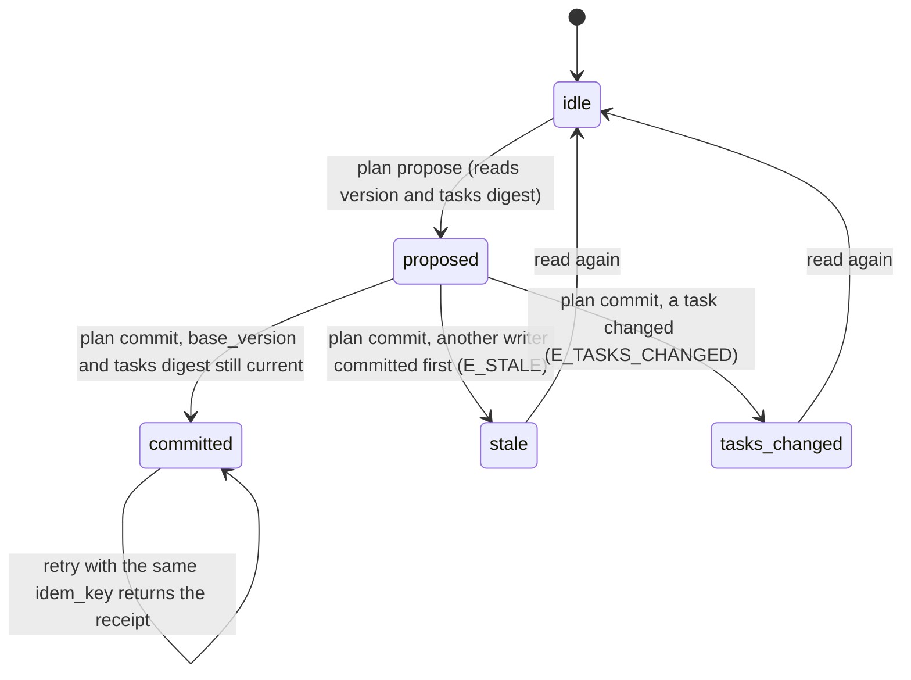
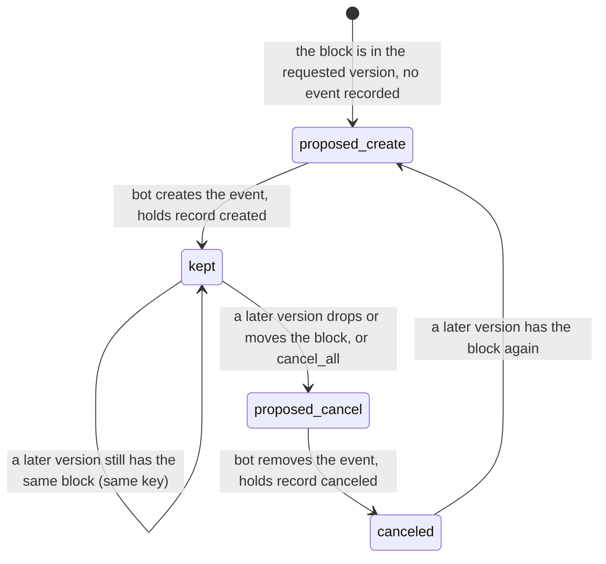

# spec

TLA+ models of the behavior people rely on, checked by TLC, the TLA+ model checker.

- `X.tla` with `X.cfg` is a model. TLC must find no error in it.
- `broken/Y.tla` with `broken/Y.cfg` is a copy of a model with one protection removed. TLC must catch it breaking the invariant listed for it in `broken/EXPECTED.json`.

A broken variant that passes, breaks a different invariant, or cannot be read fails the check: it means the model would not catch the mistake it was written to catch.

## PlanCommit

`PlanCommit.tla` models `plan commit`, a retry of it, and `plan clone` for one plan id, with two writers and a task module whose tasks can change at any moment. A writer proposes from the version and the tasks it read; the commit is one transaction.



| Invariant | In plain words |
|---|---|
| `NoLostUpdate` | Every stored version was committed from the version just before it. Two writers who proposed from the same version cannot both commit. |
| `CommittedForCurrentTasks` | A stored version was proposed for the tasks as they were when it was committed. |
| `OneVersionPerApproval` | One approved commit makes one version, however often it is retried. |
| `ReceiptNamesOwnVersion` | The answer a retry returns names the version that writer's commit created. |
| `CloneLeavesSourceAlone` | The versions a clone copied are still exactly as they were in the source. |

Broken variants: `CommitIgnoresBase`, `CommitIgnoresTasksDigest`, `RetryCommitsAgain`, `CloneSharesSource`.

## HoldLifecycle

`HoldLifecycle.tla` models the calendar holds of one plan across versions. A version is a set of blocks. The bot creates or cancels a calendar event for a proposed hold and records it; the model treats "act and record" as one step, which is what the bot skill asks for.



| Invariant | In plain words |
|---|---|
| `NeverCreatedTwice` | A block never has two live calendar events. |
| `RecordMatchesCalendar` | The events recorded as created are exactly the events on the calendar. |
| `KeptIsNeverProposedAgain` | A hold recorded as created is never proposed for creation again. |
| `DroppedIsProposedForCancel` | An event whose block the current version no longer has is proposed for cancel until it is recorded as canceled. |

Broken variants: `HoldKeyIncludesVersion` (an unchanged block gets a new key in the next version and is created twice) and `CancelOnlyFromCurrentVersion` (an event for a dropped block is never proposed for cancel).

## Run it

```text
mise trust && mise install
npm run tlc
```

[mise](https://mise.jdx.dev) installs the Java version pinned in `.mise.toml`. The same file pins `tla2tools.jar` (TLC) by exact address and SHA-256; `scripts/tla2tools.mjs` downloads it once into a cache directory and refuses a file whose hash differs. `npm run tlc` runs `tlc -workers 1 -config X.cfg X.tla` for every `.cfg` and ends with a table of what each model had to do and did.
